# 아이언웍스 번역기 / Ironworks Translator

파이널판타지 14 게임 내의 채팅을 한국어로 실시간 번역해줍니다.
Translates chat log in FFXIV into Korean in realtime.

## 동작 화면

### 1. 번역 과정

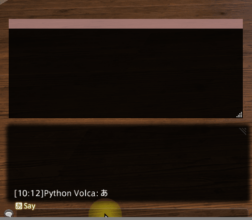

### 2. NPC 대사 번역

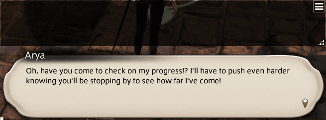

### 3. 외관 설정, 채널별 세부 설정

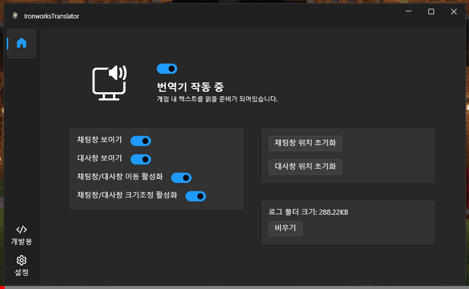

### 4. 언어 설정

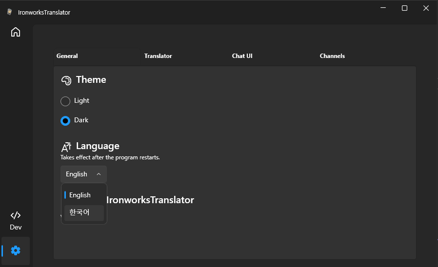

## 권장 실행환경

Windows 10 64bit 이상

## 요구 환경

설치 프로그램이 필요한 경우 .NET 10 Desktop Runtime을 함께 설치합니다.

1. 파판14를 실행한다.
2. IronworksTranslator를 실행한다.
3. (최초 실행 시) 이용 약관이 나오면 내용을 읽고 동의해주세요.
4. 번역 모델 준비 창이 없어질때까지 기다린다.
5. (최초 실행 시) 설정에서 모국어 설정과 채널별 언어 설정을 진행한다.
6. 취향에 따라 번역 모델을 선택한다.

오류 제보, 기능 추가 문의는 https://github.com/sappho192/IronworksTranslator/issues 혹은 [Discord](https://discord.gg/HJ8Y2sMjfu)로 문의바랍니다.

## 다운로드

[최신 릴리스](https://github.com/sappho192/IronworksTranslator/releases/latest)에서 `Sappho192.IronworksTranslator-win-Setup.exe` 설치 파일을 다운로드하세요.

설치 후 새 버전이 공개되면 앱 시작 시 업데이트 안내가 표시됩니다. 동의하면 앱이 업데이트 파일을 다운로드하고 자동으로 재시작합니다.

새 버전을 처음 실행하면 현재 채널의 최신 릴리스 노트를 자동으로 표시합니다. 같은 버전에서는 반복해서 열리지 않으며, 노트를 불러오지 못하면 다음 실행 때 다시 시도합니다. 대시보드의 릴리스 버튼으로도 언제든 다시 열 수 있습니다.

자체 번역 모델 파일은 앱 업데이트와 분리되어 있으며, 처음 필요할 때 다운로드됩니다. 기존 zip 배포판을 사용하던 경우 `settings.yaml`과 `data/model`이 실행 폴더에서 발견되면 사용자 데이터 폴더로 자동 복사됩니다.

[변경 내역](https://github.com/sappho192/IronworksTranslator/releases/latest)

## 사용 방법

### 직접 번역

채팅 번역창 하단의 입력란에 원하는 문장을 입력하고 `Enter`를 누르면 같은 입력란에 번역 결과가 표시됩니다.
결과는 전체 선택되므로 `Ctrl+C`로 복사하거나 바로 다음 문장을 입력할 수 있습니다.
번역 결과를 수정하지 않은 상태에서 `Enter`를 다시 눌러도 중복 번역하지 않습니다.

**설정 → 번역기**의 모국어 항목 바로 아래에서 직접 번역의 원문 언어와 번역할 언어를 설정할 수 있습니다.
이 설정은 앱을 다시 실행해도 유지됩니다. **직접 번역의 원문·번역문·역번역문을 따로 표시**를 켜면
채팅창 하단에서 세 항목을 각각 별도의 입력란으로 확인할 수 있습니다. 이 방식에서도 `Enter`로 번역합니다.
기본 방식에서는 역번역을 요청하지 않습니다. 설정에서 선택한 번역 엔진과 해당 엔진의 API 키 또는 로컬 모델을 사용합니다.

### 게임 전환과 Alt+Tab 목록

**설정 → 일반 → 창 동작**에서 다음 두 옵션을 변경할 수 있습니다. 두 옵션은 기본적으로 켜져 있으며, 기존 설정 파일에 해당 항목이 없어도 켜진 상태로 시작합니다.

- **게임에서 벗어나면 번역기 창을 숨김**: 번역이 켜져 있고 게임에 연결되어 있을 때, 게임을 최소화하거나 다른 앱으로 전환하면 채팅창과 NPC 대사창을 완전히 숨깁니다. 화면 아래쪽에 작은 최소화 창도 표시하지 않습니다. 메인 앱은 작업 표시줄로 최소화해서 다시 선택할 수 있도록 합니다. 게임이나 번역기로 돌아오면 자동으로 숨긴 창만 다시 표시하고 메인 앱의 이전 상태를 복원합니다. 사용자가 숨긴 번역창은 다시 표시하지 않으며, 번역기 설정이나 직접 번역 입력란을 사용하는 동안에는 창을 유지합니다. 게임이 종료되거나 번역 또는 이 옵션을 끄면 자동으로 숨긴 창을 다시 표시합니다.
- **Alt+Tab 목록에 메인 앱만 표시**: 채팅창과 NPC 대사창을 Alt+Tab 목록과 작업 표시줄에서 제외합니다. 옵션을 끄면 두 창을 다시 목록에 표시합니다. 앱을 다시 시작하지 않아도 적용됩니다.

### NPC 대사를 채팅창에 함께 표시

**설정 → 번역기 → NPC 대사를 채팅 번역창에 표시**를 켜면 이후 번역되는 NPC 대사가
발화자 이름과 함께 채팅 번역창에 표시됩니다. 메모리 검색 방식과 채팅 로그 방식 모두에 적용됩니다.
이 옵션이 켜져 있는 동안에는 NPC 전용 창을 숨깁니다. 옵션을 끄면 기존 전용 창 표시 설정을 다시 적용합니다.
기본값은 꺼짐이며, 이미 표시된 대사 기록은 다른 창으로 이동하지 않습니다.

### 채널별 언어 설정

프로그램 왼쪽 상단의 메뉴 아이콘을 클릭한 후, 세번째 메뉴(말풍선 모양)을 클릭하면 채널별 언어 설정이 가능합니다.
아래 그림과 같이 시스템 그룹의 언어를 클라이언트의 언어로 설정해두면 기본적인 시스템 메시지들이 본인의 언어로 번역됩니다.

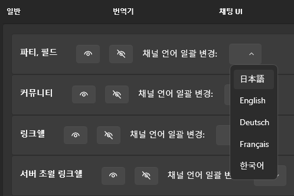

채널 별로 설정을 다르게 하고 싶으면 아래 그림과 같이 메뉴를 확장하여 언어를 변경할 수 있습니다.

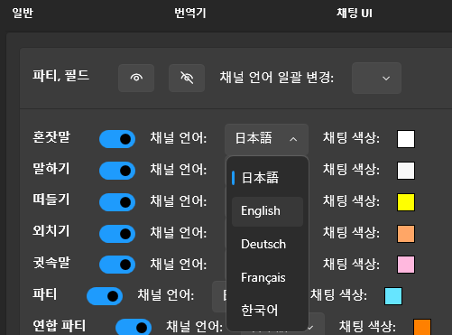

### NPC 대사 번역

기본적으로 실시간으로 NPC 대사를 번역하는 방법이 활성화됩니다.
다만 실시간 방식은 매 패치 (6.1, 6.2, 6.3 등...) 마다 막힐 수 있습니다. 그땐 제가 직접 업데이트를 공개하기 전까진 채팅 로그 방식만 이용하실 수 있으니 두 가지 방법 모두 기억해주세요.

### [실시간 메모리 검사 방식] NPC 대사가 번역되어 표시되도록 하는 방법!

1. 번역기 설정에서 아래 그림과 같이 NPC 대사 번역 방식을 "Memory Search"로 바꿔주세요.
   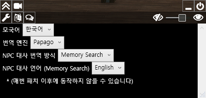
2. 채널별 설정→시스템에 있는 NPC 대사 언어를 본인 클라이언트 언어에 맞게 바꿔주세요.
   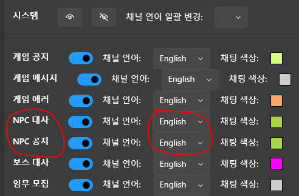

### [채팅 로그 방식] NPC 대사가 번역되어 표시되도록 하는 방법!

채팅 로그 방식은 실시간 번역이 아니며, 구조적 한계 때문에 다음 대사로 넘어가야 이전 대사의 내용이 번역됩니다.

1. 아래 그림처럼 NPC 대사 번역 방식을 `Chat Message`로, 대사 언어를 본인의 클라이언트 언어에 맞게 바꿔주세요.

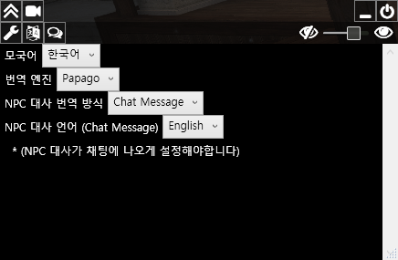

2. 채팅 설정으로 갑니다.

3. 로그 필터 중 General (맨 위에 있는 것)으로 들어갑니다.

4. Announcements 탭 (3번째 탭)에서 NPC Dialogue에 체크가 되어있도록 합니다.

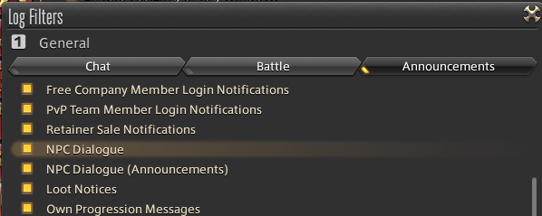

만약 게임 내 채팅창에 NPC 대사가 보이는게 싫은 분들은 아래와 같이 설정해주시면 됩니다.

1. 로그 필터 중 General (맨 위에 있는 것)으로 들어갑니다.

2. Announcements 탭 (3번째 탭)에서 NPC Dialogue에 **체크를 해제**합니다.

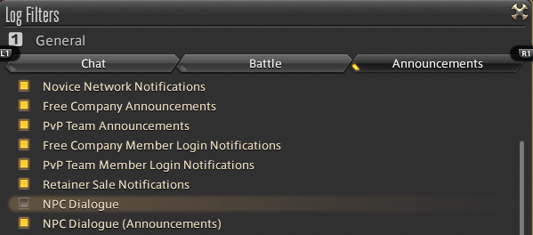

3. 로그 필터 중 Battle (두 번째)로 들어갑니다.

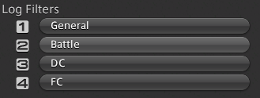

4. Announcements 탭 (3번째 탭)에서 NPC Dialogue에 체크가 되어있도록 합니다.

중요한 점은 4가지 로그 필터 중에 단 한 곳에만 NPC Dialogue가 체크되어있도록 하는 것이니 참고해주세요.
